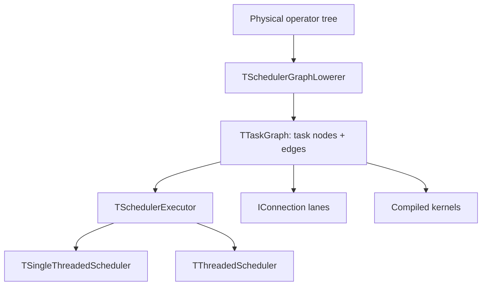
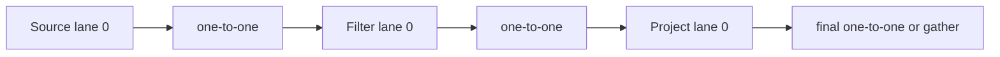
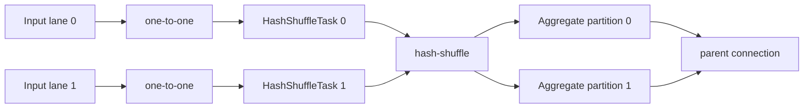
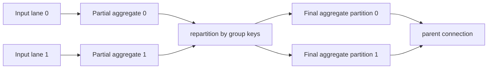
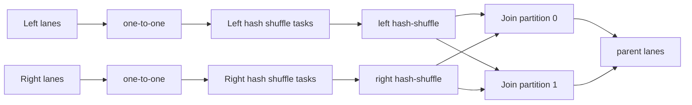
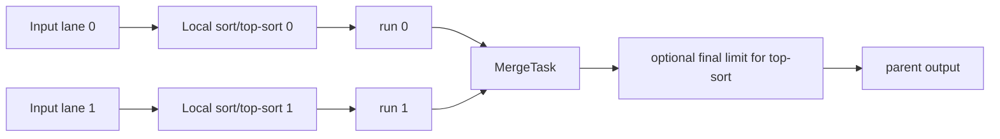

# Scheduler Runtime Architecture

This document describes the current scheduled physical runtime: how physical
operators lower into task nodes, which connections move batches between nodes,
and which compiled kernels each node uses. It is meant as a quick map for
evaluating whether a JavaScript runtime can drive the same graph while keeping
the kernels compiled in C++/WASM.

## Runtime Layers



The lowerer turns a typed physical operator tree into a graph of small runtime
tasks. Tasks own C++ state and call shared `*Code` objects. Connections are the
only data transport between tasks; they carry `TRowSet` batches and finish
signals.

Prepared code is immutable and can serve several tasks. Configuration that
depends on one task's lifetime belongs to its mutable state and is applied
before scheduling starts; it must not be captured by the shared code object.

The scheduler itself does not know SQL semantics. It only executes task nodes
and reschedules their neighbors when a task returns `OK`, `NEED_DATA`,
`BLOCKED_OUTPUT`, or `FINISHED`.

## Task State Machines

Every task exposes one scheduler method:

```text
Execute() -> OK | NEED_DATA | BLOCKED_OUTPUT | FINISHED
```

The scheduler owns only the ready/reschedule protocol. The task owns the local
state machine and returns:

| Result | Meaning | Scheduler reaction |
|---|---|---|
| `OK` | The task made progress and may have more work immediately. | Schedule the same task and its downstream tasks. |
| `NEED_DATA` | The task cannot proceed until an input produces or finishes. | Schedule upstream tasks. |
| `BLOCKED_OUTPUT` | The task has output but the downstream queue is full. | Schedule downstream tasks. |
| `FINISHED` | The task is done and has signalled output finish if it has output. | Mark done and schedule downstream tasks. |

### Single-threaded One-to-one Subset

If the exported graph is restricted to single-threaded execution and
`TOneToOneConnection`, the scheduler-side machines shrink to a direct
producer/consumer loop:

```text
while root not finished:
    run scheduled task
    task fetches from its one input lane
    task pushes to its one output lane
```

In that subset, no JS runtime support is needed for `TGatherConnection`,
`THashShuffleConnection`, `TBroadcastConnection`, worker queues, atomics, or
partition lane fan-out. The remaining work is exactly the operator processor
machines above: either implement them in JS over exported `TRowSet` memory, or
expose each processor as a WASM node adapter with `push/finish/next/destroy`.

## Connections

| Connection | Cardinality | Fetch behavior | Used for | Cost model |
|---|---:|---|---|---|
| `TOneToOneConnection` | N -> N | destination `i` reads source `i` | normal streaming edges, single-lane blocking input, single-lane final output | Cheapest connection; preserves partitioning. |
| `TGatherConnection` | N -> 1 | one destination round-robins over source lanes until all finish | global blocking operators, final output with multiple lanes, scalar side gather | Serializes lanes; useful only when semantics require one consumer. |
| `THashShuffleConnection` | N -> M | destination `j` reads from every source lane routed to partition `j` | grouped aggregate, window, and equi-join partitioning | Expensive boundary: hash kernel, routing, buffering/materialization. Carries the repartition key contract; `DstCount()` is the partition count. |
| `TBroadcastConnection` | 1 -> N | every destination receives a shared copy | cross join scalar side, late lookup locators | Sends a shared copy to each destination lane. |

Every connection is made of bounded rowset queues plus finish state. The graph
stores edges with `(connection, srcLane, dstLane)` so diagnostics can print the
same logical connection between multiple task pairs.

`THashShuffleConnection::Repartition()` returns the physical
`TRepartitionSpec`. The spec has the column names for the hash kernel. A task
routes each row. The connection states which partition rule the task uses.

## Compiled Kernels

A hash kernel writes `hashes[i]` only for rows in `TRowSet::Selection`. The slot
of an unselected row holds whatever the caller put there, so it is not a hash.
Every reader of `TRowSet::Hash` or of a hash kernel's output checks the
selection first: the shuffle when it routes and gathers rows, the runtime filter
kernel when it builds and probes, and the join and aggregate kernels that take a
precomputed hash. A selection only shrinks on the way downstream, so a row that
is still selected always has its hash.

The important ownership split is:

| Layer | Owns | Does not own |
|---|---|---|
| Compiled kernel | row-level/vector-level computation over `TRowSet` ABI and caller buffers | scheduling, queues, graph state, scan/sink lifetime |
| Task code | call order, `TRowSet` retention/release, processor transitions | thread scheduling and ready queue policy |
| Connection | rowset transport and finish propagation | SQL semantics |
| Scheduler | choosing which task runs next | rowset interpretation and kernel internals |

## Common Graph Shapes

### Streaming unary pipeline



The scheduler dispatches tasks, but filter/project semantics live in
`TUnaryCode`. A JS runtime would need to implement this task and connection
protocol; the filter/project computation can stay in WASM kernels.

### Grouped aggregate without local reduction



The shuffle computes hashes first, then either emits selection-view rowsets or
materializes accumulated rows when batching crosses the configured thresholds.
The byte threshold also bounds the full visible input payload referenced by
each destination buffer. A sparse selection can retain far more input than its
selected output contains; counting only output would pin scan batches until
EOF. References shared across destinations are charged conservatively. A single
input at the retention limit is copied when its view selects only part of the
input, so a downstream blocking operator does not inherit the large owner.
Dense single-input batches can remain views. One oversized input can exceed
the threshold. Queued dense views keep their input alive until consumed.
Pending output is drained before reading another input,
so backpressure does not grow the buffered set. This bounds visible references,
not opaque source allocations or process RSS.
Aggregate tasks own separate hash table state; compiled aggregate kernels are
shared.

### Grouped aggregate with local reduction



The scheduler selects this plan only when the input has at least 1,048,576
rows. Statistics must also show at least 8x fewer groups than rows. Each partial
lane builds local groups before it sends rows to the exchange. The final phase
merges partial states. It changes `count` to `sum`. It keeps `sum`, `min`, and
`max` as they are. All lanes in one phase use the same compiled code object.

The executable plan marks the stages as `partial` and `final`. The hash-shuffle
connection between them stores the group keys in `TRepartitionSpec`. The plan
does not hide this fact in task names.

### Partitioned equi-join



Each join partition owns its own `TInnerJoinProcessor`, two hash tables and row
stores. The compiled join kernels are shared between partition states.

### Partitioned sort / top-sort



Merge is currently a C++ processor over sorted row-id runs. The radix sort
kernel accelerates local sorting when all keys are supported.

## JavaScript/WASM Runtime Boundary

The current graph is already close to a portable dispatcher model: graph
topology, task kind, connection kind, lane ids, and kernel handles are explicit.
The remaining C++ coupling is mostly in task state and rowset lifetime helpers.

### Border for a distributed scheduler

The task graph is the physical plan for worker placement. The browser exec plan
hides route tasks, so it is not the worker placement plan. A distributed
scheduler can use these steps:

1. Put source, unary, and partial aggregate task groups on workers.
2. Read the keys from `TRepartitionSpec`.
3. Read the partition count from the destination lane count.
4. Assign destination lanes to workers.
5. Send `TRowSet` batches over a network connection with the same
   push/fetch/finish rules.
6. Run final aggregate task groups. Each partition has its own state.

`BuildAggregateCombineOperator` creates the final aggregate. This rule does not
belong to a scheduler. The exec plan also has `Single`, `Partial`, and `Final`
aggregate phases. A distributed scheduler still needs a wire format, flow
control, error recovery, and a placement policy. It does not need to find the
aggregate keys again or change a single aggregate after worker placement.

Runtime join filters use a query-scoped id in the logical join. For a join with
an emitted filter, `LowerPlanToGraph` uses hash-shuffle tasks to build and apply
it, including when there is only one lane and no partition redistribution. It
asks an `IRuntimeFilterBindingFactory` for separate producer and probe endpoints.
The default local factory binds both to one `TRuntimeFilter`. A producer hands
off a value-only `TRuntimeFilterPartial`
containing exact hashes or a 64-byte blocked Bloom fragment. Exact sets are
used up to 16K distinct hashes; larger contributions switch to Bloom. A
distributed factory can send each partial to a merger and make the published
result available to probe workers.
The merger must wait for every producer before publishing. Consumer tasks wait
for publication before reading rows. Network encoding, global completion
tracking, and worker failure handling remain part of a distributed runtime.
Every worker must also
use the same join-key hash representation for filter publication and probing.

Locally, each producer moves its contribution into a separate slot at input
EOF, before waiting for buffered shuffle output to drain. The last producer
merges the contributions and publishes immutable filter data with a release
store; probes acquire it before reading. No merger mutex is needed. One Bloom
fragment supplies the result's storage, and the other fragments are OR-ed into
it. Bloom sizes are powers of two so both scalar and vector probes use a block
mask instead of division.

Each probe task owns its counters, selection scratch buffers, and weak-Bloom
pause policy. Worker migration does not move this state between tasks. Aggregate
instrumentation snapshots are read only after execution stops. Before allocating
a mask or computing filter hashes, a task checks whether the filter is ready and active.
An inactive filter passes the batch through. Source-computed hashes share the
source rowset's lifetime through shuffle views; materialized shuffle batches
gather their existing hashes alongside the columns.

Every operation on filter contents runs in the `runtime-filter` kernel
(`qdb/kernel/join/runtime_filter.oz`): key accumulation and deduplication, the
exact table, Bloom insertion, merging and probing. It compiles with the query
kernels when the first join with a filter is lowered. The query's
`TRuntimeContext` holds it and is passed to the binding factory, so a filter
cannot be created without it.

The kernel has three entry points, each called once per batch: `rf_build` adds
a batch to a producer's contribution, `rf_publish` merges the contributions,
and `rf_probe` tests a batch. They work on state structs that point to storage
provided by C++. `rf_build` returns early when it needs storage it was not
given, such as the Bloom words on overflow, and continues from the same row.
`TRuntimeFilter` keeps the buffers, producer completion, publication, counters
and the pause policy. Bloom probes of fewer than 8192 selected rows are scalar;
larger batches use the vector probe, which first packs the selected hashes so
that every vector lane carries a live row.

`AttachRuntimeFilters` estimates how many probe rows the filter can reject from
the build and probe key NDVs. It compares saved shuffle and join work with the
cost of building and probing the filter, including a penalty when attaching the
filter forces a build-first join below the usual 10:1 asymmetry threshold.
Approximate NDVs, including products of column NDVs for composite keys, get a
safety margin; missing NDVs or a nonpositive estimated benefit leave the join
unfiltered. These work weights are heuristics and need
calibration against representative queries before relying on them for precise
latency predictions.
